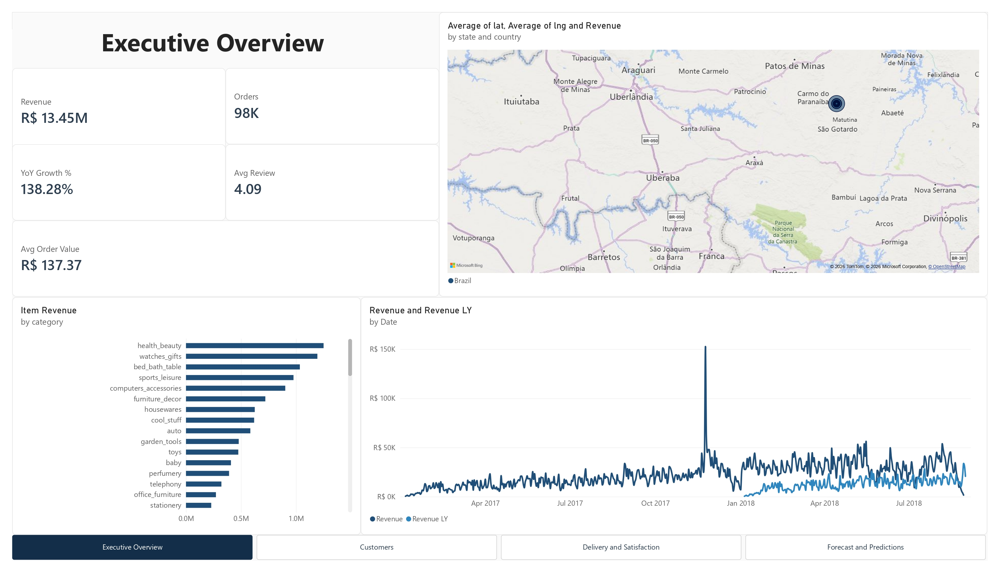
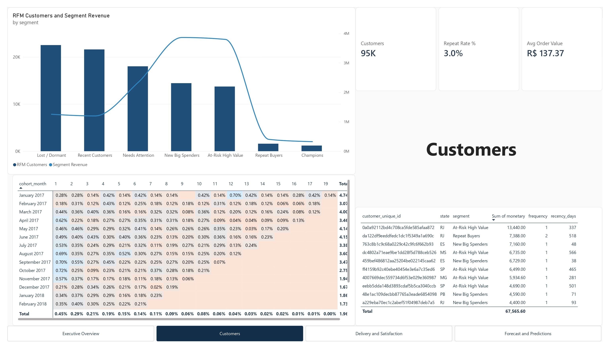
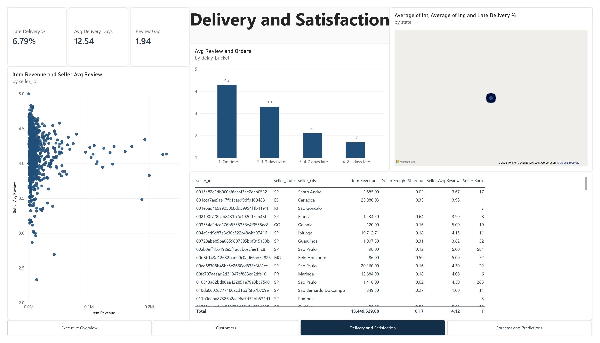
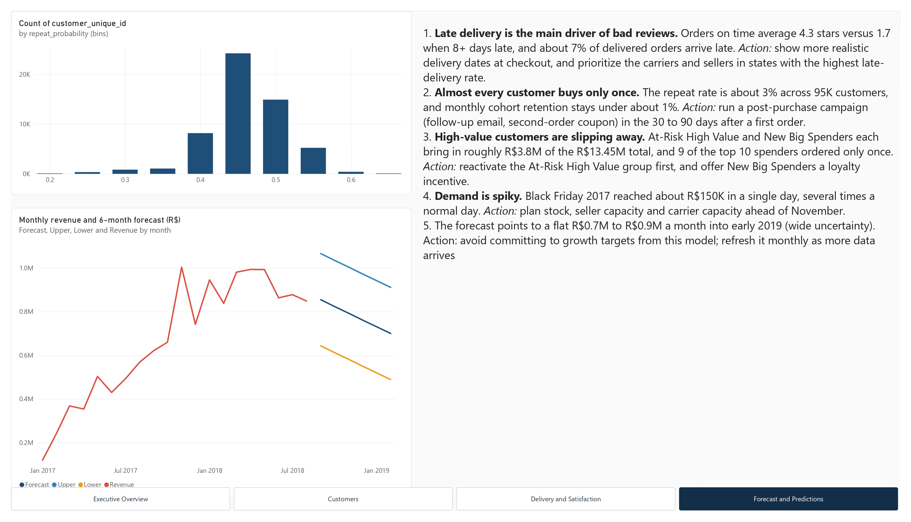

# Olist E-commerce Analytics: SQL + Python + Power BI

An end-to-end analytics project on ~100K Brazilian e-commerce orders. Raw CSVs are loaded into PostgreSQL, modeled as a star schema with SQL, extended with Python forecasting and a repeat-purchase model, and presented in a 4-page Power BI dashboard with business recommendations.



## Table of contents

1. [Business problem](#business-problem)
2. [Key findings](#key-findings)
3. [Recommendations](#recommendations)
4. [Dashboard pages](#dashboard-pages)
5. [Tech stack](#tech-stack)
6. [Data](#data)
7. [Data model](#data-model)
8. [Methodology](#methodology)
9. [How to run it](#how-to-run-it)
10. [Project structure](#project-structure)
11. [Limitations](#limitations)
12. [Next steps](#next-steps)
13. [Credits and license](#credits-and-license)

## Business problem

Olist is a Brazilian marketplace that connects small sellers to large online stores. This project acts as the analytics team for the business and answers three questions:

1. **Where does revenue come from?** (categories, states, trend over time)
2. **How healthy is customer retention?** (RFM segments, cohort retention, repeat rate)
3. **How does delivery performance affect customer satisfaction?** (late deliveries, review scores, seller quality)

Stakeholders: the commercial team (revenue and categories), the CRM team (retention), and the logistics team (delivery and sellers).

## Key findings

Analysis window: **January 2017 to August 2018**, about 98K valid orders and 95K unique customers.

| Metric | Value |
|---|---|
| Revenue | R$ 13.45M |
| Orders | ~98K |
| Average order value | R$ 137.37 |
| Average review score | 4.09 / 5 |
| Average delivery time | 12.5 days |
| Late deliveries (of delivered orders) | ~7% |
| Repeat customer rate | ~3% |

1. **Late delivery is the main driver of bad reviews.** Average review score falls from **4.3** (on time) to **3.3** (1 to 3 days late), **2.1** (4 to 7 days late) and **1.7** (8+ days late). The gap between on-time and late orders is about 1.9 stars.
2. **Almost every customer buys only once.** Only about **3%** of 95K customers placed a second order, and monthly cohort retention stays below roughly 1%.
3. **High-value customers are at risk.** The *At-Risk High Value* and *New Big Spenders* segments each bring in roughly **R$ 3.8M** of revenue, and 9 of the top 10 spenders ordered only once.
4. **Demand is spiky.** Black Friday 2017 produced a single day of about **R$ 150K** in revenue, several times a normal day.
5. **Forecast:** a baseline model expects revenue to stay in a flat range of roughly R$ 0.7M to R$ 0.9M per month into early 2019.


## Recommendations

| # | Finding | Action |
|---|---|---|
| 1 | Orders 8+ days late average 1.7 stars versus 4.3 on time. | Show realistic delivery dates at checkout, and prioritize carriers and sellers in states with the highest late-delivery rate. |
| 2 | Only ~3% of customers return. | Run a post-purchase campaign (follow-up email, second-order coupon) in the 30 to 90 days after a first order. |
| 3 | At-Risk High Value and New Big Spenders hold about R$ 3.8M each. | Reactivate At-Risk High Value customers first, and offer New Big Spenders a loyalty incentive. |
| 4 | Black Friday drives a revenue spike. | Plan stock, seller capacity and carrier capacity ahead of November. |
| 5 | Revenue is concentrated in a few states and categories. | Recruit sellers outside the top state and diversify beyond the top categories. |

## Dashboard pages

| Page | Question it answers | Main visuals |
|---|---|---|
| **1. Executive Overview** | How is the business doing? | KPI cards, revenue vs prior year, top 10 categories, revenue by state map |
| **2. Customers** | Who buys and do they come back? | RFM segment chart, cohort retention heatmap, top customers table, repeat rate |
| **3. Delivery and Satisfaction** | Is logistics hurting reviews? | Review score by delay bucket, late delivery % by state, seller scatter, top sellers table |
| **4. Forecast and Predictions** | What happens next? | Revenue forecast with confidence band, repeat-purchase score distribution, recommendations |





## Tech stack

| Layer | Tool |
|---|---|
| Storage and transformation | PostgreSQL 16, SQL views |
| Data science | Python (pandas, SQLAlchemy, scikit-learn, statsmodels) |
| Visualization | Power BI Desktop (data model, DAX, 4-page report) |
| Version control | Git and GitHub |

## Data

- **Source:** [Brazilian E-Commerce Public Dataset by Olist](https://www.kaggle.com/datasets/olistbr/brazilian-ecommerce) on Kaggle.
- **Size:** about 100K orders (2016 to 2018) across 9 CSV files.
- **Analysis window:** Jan 2017 to Aug 2018. Late 2016 and the months after August 2018 are sparse, so they are excluded.
- The raw CSVs are **not** included in this repository. Download them from Kaggle (see [How to run it](#how-to-run-it)).

Data quality decisions:

- `customer_id` is unique per order. Customers are identified by `customer_unique_id`.
- Canceled and unavailable orders, and orders with no items, are flagged by `is_valid` and excluded from revenue.
- Orders with several reviews or payments are aggregated to one row per order.
- The geolocation table (about 1M rows) is averaged to one latitude and longitude per zip prefix.

## Data model

A star schema built with SQL views in the `analytics` schema:

```text
                  dim_customers      dim_products      dim_sellers
                        \                 |                 /
 Date --- fact_orders ---+--- fact_order_items ------------+
              |
   customer_rfm, cohort_retention, revenue_forecast, repeat_propensity
```

| Object | Grain | Purpose |
|---|---|---|
| `fact_orders` | one row per order | revenue, delivery delay, review score, payment info |
| `fact_order_items` | one row per order item | category and seller analysis |
| `dim_customers` | one row per unique customer | state, city, coordinates |
| `dim_products` | one row per product | English category names |
| `dim_sellers` | one row per seller | seller location |
| `customer_rfm` | one row per customer | recency, frequency, monetary scores and segment |
| `cohort_retention` | cohort month x months since | retention counts |
| `revenue_forecast` | one row per month | actuals, forecast and bounds (from Python) |
| `repeat_propensity` | one row per customer | repeat-purchase score (from Python) |

## Methodology

**SQL**
- Star schema with views, one row per order in `fact_orders`.
- Delivery metrics: `delivery_days`, `delay_days`, `is_late`, and `delay_bucket` (on time, 1 to 3, 4 to 7, 8+ days late).
- RFM segmentation using `NTILE(5)` for recency and monetary value, and rule-based frequency scores (since most customers have one order).
- Cohort retention by first purchase month.

**Python**
- `forecast.py`: Holt-Winters exponential smoothing (additive trend, damped if configured) for a 6-month revenue forecast, with a 3-month holdout backtest and residual-based bounds.
- `repeat_model.py`: logistic regression baseline and gradient boosting classifier to predict repeat purchase from first-order features, with a stratified train/test split and class weighting for imbalance. Evaluated with ROC-AUC and PR-AUC.

**Power BI**
- Import mode, relationships from dimensions to facts, and a dedicated Date table.
- 25+ DAX measures in a `_Measures` table: revenue, orders, average order value, YoY growth, late delivery %, review gap, seller-level review and freight share, cohort retention, and more.
- Consistent theme, page navigation, and drill-through and tooltip pages.

## How to run it

**Requirements:** Python 3.10+, PostgreSQL 15 or 16, Power BI Desktop (Windows), and Git.

```bash
# 1. Clone and set up
git clone https://github.com/Abhishekteja443/olist-analytics.git
cd olist-analytics
python -m venv .venv
.venv\Scripts\activate          # Windows
# source .venv/bin/activate     # Mac/Linux
pip install -r requirements.txt

# 2. Download the data into data/raw/
kaggle datasets download -d olistbr/brazilian-ecommerce -p data/raw --unzip

# 3. Create the database
psql -U postgres -c "CREATE DATABASE olist;"

# 4. Load raw CSVs into PostgreSQL
python src/load_raw.py

# 5. Build the analytics views
psql -U postgres -d olist -f sql/01_views.sql

# 6. Run the Python models
python src/forecast.py
python src/repeat_model.py
```

Notes:

**Open the dashboard:** open `powerbi/olist_dashboard.pbix` in Power BI Desktop. It uses Import mode, so it opens without a database connection. To refresh it, point the data source at your own PostgreSQL server (*Home > Transform data > Data source settings*) and rename the tables to drop the `analytics ` prefix if Power BI adds it.

Execution order matters: SQL views before the Python scripts, because the scripts read from the views and write their results back to the `analytics` schema.

## Project structure

```text
olist-analytics/
  data/raw/                  Raw Kaggle CSVs (not committed)
  sql/
    01_views.sql             Star schema, RFM, cohort views
  src/
    load_raw.py              Load CSVs into PostgreSQL
    forecast.py              6-month revenue forecast
    repeat_model.py          Repeat-purchase model
  powerbi/
    olist_dashboard.pbix     Power BI report
    theme.json               Report theme
  images/                    Dashboard screenshots
  requirements.txt
  README.md
```

## Limitations

- **Short history:** about 20 months of data, with no full seasonal cycle. The forecast is a baseline trend model, and the Black Friday 2017 spike can distort it. Treat it as a rough range, not a target.
- **Few repeat buyers:** with a ~3% repeat rate, retention metrics and the repeat-purchase model have little signal. Model scores are relative rankings, not calibrated probabilities (class weighting inflates them).
- **In-sample scoring:** scores in the dashboard are computed on all customers, including those used for training. Use the test-set ROC-AUC as the performance figure.
- **Delivered orders only** feed the RFM and cohort tables, so totals can differ slightly from headline revenue.
- **Anonymized data:** there is no customer demographic or marketing channel data, so causes of low retention cannot be tested directly.
- Observational data cannot prove that late delivery *causes* low reviews, only that they move together.

## Next steps

- Customer lifetime value (CLV) estimation
- A/B test of delivery-date messaging at checkout
- Seller scorecards combining delivery time, freight share and reviews
- Sentiment analysis on review comments (Portuguese text)
- Scheduled refresh with a Power BI gateway

## Credits and license

- Data: Olist, *Brazilian E-Commerce Public Dataset*, via Kaggle. Check the dataset page for its license terms (published for open, non-commercial use at the time of writing) and credit Olist if you reuse it.
- Code in this repository: 

**Author:** Abhishek Teja Goli